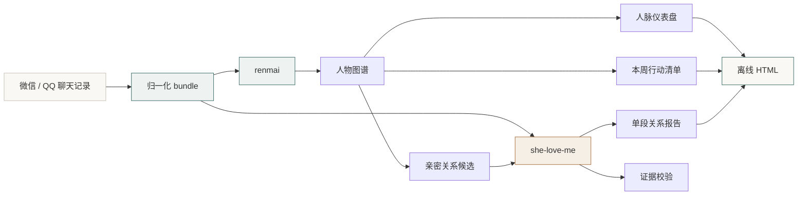
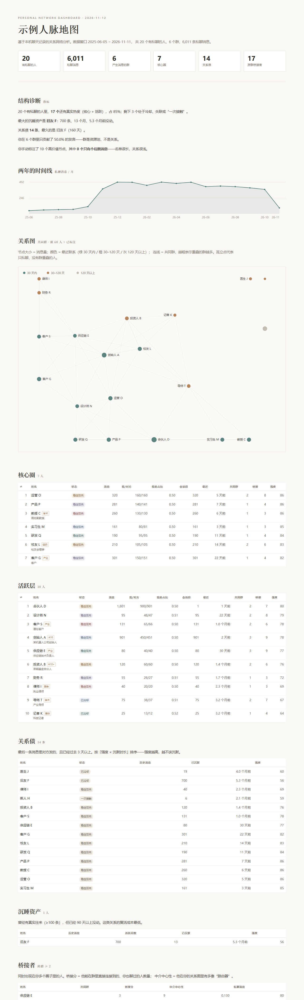

<div align="center">


<br/>

**把聊天记录，变成一张可执行的关系地图。**

看一段关系，也看整张网。

<br/>

[](LICENSE)
[]()
[]()
[]()
[]()
[]()
[]()

[快速开始](#30-秒体验) · [两个-skill](#两个-skill一套数据) · [输出示例](#你会得到什么) · [命令速查](#命令速查) · [隐私](#证据与隐私)

</div>

---

> **两个 Agent Skill，一套数据。**
>
> `she-love-me` 看**一段关系**：她是不是真的不一样。
>
> `renmai` 看**整张网**：谁在核心、谁在冷却、谁能在群里把你介绍给另一圈人。
>
> 恋爱不是人脉之外的东西——它是网里最强的一条边。所以这一层，也被画进了图里。

---

## 目录

- [这是什么](#这是什么)
- [一张图看懂](#一张图看懂)
- [两个 Skill，一套数据](#两个-skill一套数据)
- [你会得到什么](#你会得到什么)
- [30 秒体验](#30-秒体验)
- [真实数据：从导出到报告](#真实数据从导出到报告)
- [指标怎么算](#指标怎么算)
- [证据与隐私](#证据与隐私)
- [命令速查](#命令速查)
- [项目结构](#项目结构)
- [FAQ](#faq)
- [路线图](#路线图)
- [致谢](#致谢)

---

## 这是什么

不是“聊天记录导出器”，也不是“恋爱打分器”。它做三件事：

| | 你得到什么 | 怎么做到 |
|---|---|---|
| **看清一段关系** | 依恋模式、正负比、危险信号、军师建议 | 全量统计 + 分层采样 + 证据引用 + AI 解读 |
| **看清一张网络** | 核心圈 / 关系债 / 沉睡资产 / 桥接者 / 结构洞 | 人物图谱 + 图指标 + 人工标注两条轴 |
| **知道下一步** | 本周该找谁、说什么、为什么是他 | 规则引擎 + 优先级排序 |

**三条设计原则：**

1. **本地优先**——所有计算在本机，报告是单文件 HTML，不上传。
2. **证据优先**——每条关键结论必须能落回消息 ID 或统计字段，报告可复查。
3. **行动优先**——报告的最后一定是“本周做什么”，不是“总结”。

---

## 一张图看懂



**数据只导出一次**，两条分析线共用同一份 `data/contacts/`。

---

## 两个 Skill，一套数据

| | `she-love-me` | `renmai` |
|---|---|---|
| **视角** | 两个人 | 一张网 |
| **输入** | 一个联系人 bundle | 全部 bundle + 群成员 + 标注 |
| **核心指标** | 依恋类型、Gottman 比值、Sternberg 三角、对称性 | 关系强度、桥接、中介中心性、结构洞约束 |
| **输出** | 恋爱关系报告 | 人脉仪表盘 + 周报 + 单人档案 |
| **证据** | `msg_` ID + 统计字段 + 原文回查 | 同样的协议，报告默认隐藏原文 |
| **入口** | `.agents/skills/she-love-me/SKILL.md` | `.agents/skills/renmai/SKILL.md` |

`renmai` 的**亲密关系层**会调用 `she-love-me` 的引擎做单段深潜：

```
全量关系图
  └─ 亲密候选（深夜 / 关键词 / 连续天数 / 媒体占比 / 双向均衡）
       └─ 用户确认
            └─ she-love-me：stats → 采样 → 报告
```

> 候选只是“值得看一眼”，不是“他们在谈恋爱”。工具不替你判断感情。

---

## 你会得到什么

### 1. 一份能复查的关系报告


- 全量统计与分层采样分离，长对话不会被截断
- 每条判断带消息 ID，引用原文可回查
- 危险信号必须同时满足量化与文本双阈值

### 2. 一张人脉仪表盘



- **14 个章节**：结论 → 结构诊断 → 时间线 → 关系图 → 亲密候选 → 核心圈 → 活跃层 → 关系债 → 沉睡资产 → 桥接者 → 群资源 → 覆盖度 → 本周行动 → 全量名册
- 关系图用确定性力导向布局，节点大小 = 消息量，颜色 = 最近联系
- 全部离线，单文件，可直接发给别人

### 3. 每周三件事

```markdown
# 本周人脉行动清单 · 2026-11-13

1. 张三（关系债，25 天）
   - 为什么：最后一条是对方发的，已 25 天
   - 做什么：回一条具体的话，别只回“在”

2. 李四（沉睡资产，150 天）
   - 为什么：曾经 5000 条，已沉睡 150 天
   - 做什么：用共同经历做切口，一条消息即可

3. 王五（一次接触，3 天）
   - 为什么：加了好友但只有 6 条对话
   - 做什么：48 小时内补一个具体信息或请求
```

### 4. 单人档案

每个人的时间线、共同群、通过群能连到的人。

---

## 30 秒体验

不需要任何真实数据：

```bash
git clone https://github.com/weihaoyang/she-love-me
cd she-love-me
python -m pip install -r requirements.txt

python scripts/network_demo.py
```

打开 `data/network_demo/reports/dashboard.html`，你会看到一份用虚构人物生成的完整仪表盘。

> 合成数据：20 人、6 个群、6,011 条消息，覆盖核心圈 / 关系债 / 沉睡 / 桥接全部场景。

---

## 真实数据：从导出到报告

### 第一步：导出聊天记录

Windows 微信（4.x）推荐 `weflow-cli`；QQ 用 QCE。完整步骤、权限与回退方案见：

```
.agents/skills/she-love-me/references/data-sources.md
```

也可以直接使用已有的 JSON / Markdown 导出，不需要重新提取数据库。

### 第二步：跑人脉分析

```bash
# 一条命令：构图 → 亲密候选 → 分析草稿 → 报告 → 周报 → 档案
python scripts/network_pipeline.py --input data/contacts --top 10 --deep 3
```

或者分步：

```bash
python scripts/network_build.py --input data/contacts --output data/network
python scripts/network_intimacy.py --graph data/network/graph.json
python scripts/network_analyze.py --graph data/network/graph.json --top 10
python scripts/network_report.py --graph data/network/graph.json \
  --analysis data/network/analysis.json --output reports/network/dashboard.html
python scripts/network_weekly.py --graph data/network/graph.json
```

### 第三步：跑恋爱分析

```text
Claude Code:  /she-love-me
Codex:        $she-love-me
Cursor:       直接说「用 she-love-me 分析我和某某的聊天」
```

Skill 会引导你完成统计、采样、AI 分析和报告生成。

### 可选：补两条人工轴

聊天记录能算出**关系强度**，算不出**谁有资源**。后者只能由你标注：

```json
{
  "wxid_xxx": {
    "tier": "A10",
    "role": "某公司创始人",
    "next": "这周给他一页纸"
  }
}
```

模板见 `examples/network/labels.example.json`。

---

## 指标怎么算

所有指标都从**单聊消息**计算；群聊只用于“共同群 / 桥接”。

| 指标 | 定义 |
|---|---|
| **会话段** | 相邻消息间隔 > 6 小时切一段 |
| **关系强度** | 频率 28% + 近因 30% + 双向均衡 18% + 持续度 12% + 回复速度 12% |
| **关系债** | 最后一条是对方发的，且 ≥3 天；优先级 = 强度 × 沉默时长 |
| **沉睡资产** | ≥100 条历史消息，90–730 天没动 |
| **桥接分** | 他能在共同群里直接连接到的、你也聊过的人数 |
| **中介中心性** | 共同群图上的 Brandes betweenness |
| **结构洞约束** | Burt's constraint，越低越像“跨界者” |
| **亲密候选** | 0.28 强度 + 0.20 深夜 + 0.20 关键词 + 0.12 连续 + 0.10 均衡 + 0.10 媒体 − 共同群折扣 |

完整公式与阈值：`.agents/skills/renmai/references/metrics.md`

---

## 证据与隐私

### 证据协议

```json
{
  "evidence_level": "medium",
  "evidence_message_ids": ["msg_..."],
  "stats_fields": ["person.wxid_x.total", "stats.debt"],
  "quote": "消息中的真实连续片段"
}
```

报告生成前会校验：消息是否存在、原文是否匹配、统计字段是否有效、数据摘要是否一致。
**引用通过 ≠ 推断成立**，只代表锚点真实。

### 隐私设计

- 全部本地计算，无网络请求
- 报告不含聊天原文，`--show-quotes` 才显示
- `data/`、`reports/`、`vendor/`、`scripts/tmp/` 全部在 `.gitignore`
- 不提供“查人 / 背景调查”能力，不给第三方排名
- 发布前自检：

```bash
python scripts/privacy_scan.py
```

扫描手机号、身份证、真实 wxid、消息 ID、超长数字。完整清单见 [PUBLISH_CHECKLIST.md](PUBLISH_CHECKLIST.md)。

---

## 命令速查

### 人脉

| 命令 | 作用 |
|---|---|
| `network_pipeline.py` | 一键跑完全流程 |
| `network_build.py` | 构图、算指标、导出 CSV |
| `network_intimacy.py` | 亲密关系候选（待确认） |
| `network_deepdive.py` | 用 she-love-me 引擎深潜单段关系 |
| `network_analyze.py` | 生成证据版 `analysis.json` 草稿 |
| `network_context.py` | 按人 + 关键词/消息 ID 补取证据 |
| `network_evidence.py` | 校验证据 |
| `network_report.py` | 生成仪表盘 |
| `network_weekly.py` | 本周行动清单 |
| `network_person.py` | 单人档案 |
| `network_ask.py` | `person` / `path` / `debt` / `who` / `gaps` |
| `network_names.py` | 从 `contact.db` 还原名称 |
| `network_demo.py` | 合成数据演示 |
| `privacy_scan.py` | 发布前隐私扫描 |

### 恋爱

| 命令 | 作用 |
|---|---|
| `stats_analyzer.py` | 全量统计 |
| `build_chat_history.py` | 分层采样 |
| `generate_html_report.py` | 生成报告 |
| `analysis_evidence.py` | 证据校验 |
| `query_chat_context.py` | 按消息 ID 补上下文 |
| `scoring_calibration.py` | 评分校准 |

---

## 项目结构

```
.
├── .agents/skills/
│   ├── she-love-me/          # 恋爱分析 Skill
│   └── renmai/               # 人脉分析 Skill
│       ├── SKILL.md
│       └── references/
│           ├── data-model.md
│           ├── metrics.md
│           ├── analysis-framework.md
│           ├── intimacy.md
│           ├── playbook.md
│           └── output-schema.md
├── scripts/                  # 所有可执行脚本（Python）
│   ├── network_*.py          # 人脉分析
│   └── *.py                  # 恋爱分析 / 导出 / 转换
├── tests/                    # 143 个单元与端到端测试
├── examples/network/         # 标注模板
├── docs/network/             # 人脉分析文档
├── assets/                   # banner 与预览图
├── data/                     # 本地聊天数据（ignored）
└── reports/                  # 本地报告（ignored）
```

---

## FAQ

**Q：我没有 Windows 微信，能用吗？**
A：能。任何能生成 `messages.json` 的方式都可以：QQ（QCE）、已有 JSON、Markdown、其他导出器。数据源细则见 `references/data-sources.md`。

**Q：需要管理员权限吗？**
A：读取微信数据库需要。人脉分析本身不需要——它只读 `data/contacts/`。

**Q：会把我的聊天上传吗？**
A：不会。默认全本地。只有你主动调用云端模型做 AI 分析时，采样片段才会发给模型服务。

**Q：为什么仪表盘里有些人的“价值”是空的？**
A：因为“资源量级”只能由你标注。工具不会从聊天内容推断财富或职务。

**Q：亲密候选为什么会有明显不对的人？**
A：它是结构信号 + 关键词的启发式，误报是设计的一部分。用 `intimacy_overrides.json` 标 `excluded`，下次就不会出现。

**Q：能给别人排名吗？**
A：不能，也不提供这个能力。报告只对本人可见。

---

## 路线图

- [x] 人脉图谱与指标
- [x] 证据版分析 + 校验
- [x] 亲密关系层 + 单段深潜
- [x] 一键流水线 + 单人档案
- [ ] 时间窗对比（同比 / 环比）
- [ ] 引荐路径推荐（不只是最短路）
- [ ] 组织视角（团队 / 校友会的人脉地图）
- [ ] 更多数据源（飞书 / 钉钉 / Telegram）

---

## 致谢

- 原项目：[`863401402/she-love-me`](https://github.com/863401402/she-love-me)（MIT）
- 导出生态：`weflow-cli`、`CipherTalk`、`qq-chat-exporter`
- 所有在 issue 里反馈真实数据问题的人

本项目 fork 自原项目，在其上新增 `renmai`（人脉分析）与亲密关系层。原项目的分析框架、证据协议与导出流程保持不变。

## License

[MIT](LICENSE)
